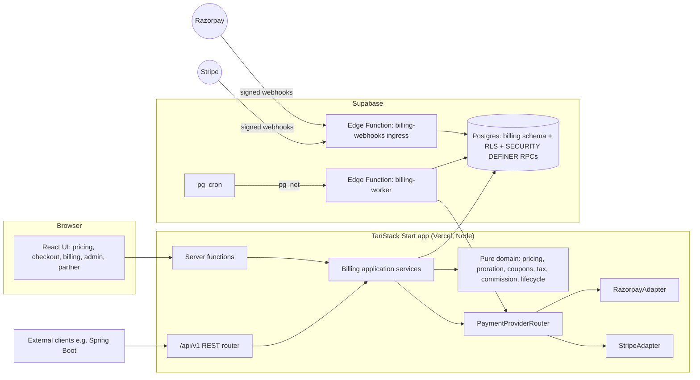
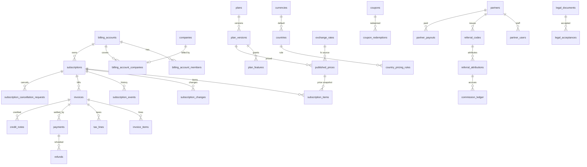
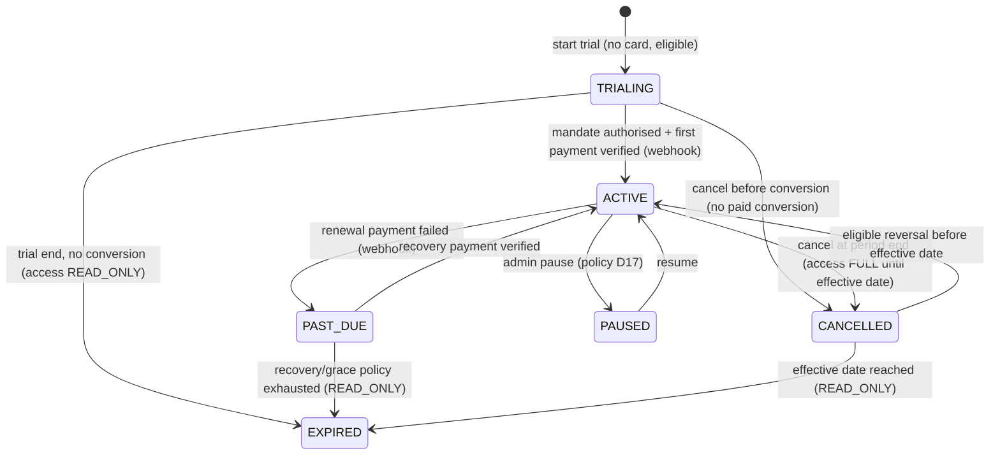

# LinkBooks Subscription & Billing Platform — Architecture and Implementation Plan

Status: **Approved 5 November 2026. Phases 1 to 10 implemented and tested locally** (see
[01-requirements.md](01-requirements.md)); not applied to the hosted database, not pushed.
Branch: `feature/rohit-dev`. Date: 5 November 2026.

This plan answers sections 1–10 and 20 of the master billing brief: inspect, identify reuse and gaps,
propose architecture, migrations, APIs, payment, security and test strategy, a file-by-file plan, open
business decisions and external dependencies.

---

## 1. Findings from the codebase inspection

### 1.1 Stack (actual, not assumed)

| Area              | Found                                                                                                                                                            | Impact on the brief                                                                                        |
| ----------------- | ---------------------------------------------------------------------------------------------------------------------------------------------------------------- | ---------------------------------------------------------------------------------------------------------- |
| Framework         | **TanStack Start 1.168** (React 19.2, Vite 8.3, Nitro `vercel` preset). **Not Next.js.**                                                                         | No App Router / server actions. Server logic uses `createServerFn` and raw HTTP routes in `src/server.ts`. |
| Language          | TypeScript 5.8, `strict`, `noUncheckedIndexedAccess`, `exactOptionalPropertyTypes`                                                                               | Already matches rule 3.                                                                                    |
| Validation        | zod 4.6 (hand-written validators common in billing code)                                                                                                         | Standardise billing input/output on zod schemas; zod 4 can emit JSON Schema for OpenAPI.                   |
| Database          | Supabase Postgres project `ipxflpzfcqwtenodbxwc`; pg_cron, pg_net, Vault in use                                                                                  | PostgreSQL stays the source of truth.                                                                      |
| Auth              | Supabase Auth; `requireSupabaseAuth` middleware (JWT `getClaims`, user-scoped client so RLS applies); MFA aal2 enforced by restrictive RLS on every public table | Reuse unchanged.                                                                                           |
| Service role      | `src/integrations/supabase/client.server.ts` (`supabaseAdmin`), server-only; `env-safety.ts` blocks secret-looking `VITE_*` variables                            | Reuse; billing writes go through SECURITY DEFINER RPCs or `*.server.ts`.                                   |
| Public env prefix | `VITE_*` (not `NEXT_PUBLIC_*`)                                                                                                                                   | `.env.example` must use the project's real names (see §9).                                                 |
| Background work   | pg_cron + pg_net + Supabase Edge Function (`reporting-worker`), `platform_jobs` worker tick, cron-secret routes in `src/server.ts`                               | Reuse this pattern for billing jobs; no `vercel.json` crons exist.                                         |
| Email             | Resend (`email-provider.server.ts`); `email_outbox` is a send log, not a queue                                                                                   | Billing notices need a real outbox.                                                                        |
| Audit             | Tenant `audit_events` is **mutable**; `platform_audit` / `platform_billing_audit` are **append-only with an MD5 hash chain**                                     | Financial audit goes to the immutable platform audit path.                                                 |
| UI                | shadcn/Radix, `PageHeader`/states, `LookupSelect` rule (`check:lookups`), money helpers with bigint minor units, `Intl.NumberFormat` formatters                  | Reuse.                                                                                                     |
| Tests             | Vitest 5 (node), 13 Playwright configs (fixture-based), Docker Postgres SQL harness (`scripts/test-*-postgres.mjs`), CI `quality.yml`                            | Extend; add a billing Postgres suite and billing Playwright config.                                        |

### 1.2 Existing billing implementation (substantial — must be extended, not duplicated)

Decision record `docs/decisions/001-extend-existing-billing.md` already forbids a second catalogue.

| Capability             | Existing implementation                                                                                                                                                                                                                                 | State                                                                                                                                           |
| ---------------------- | ------------------------------------------------------------------------------------------------------------------------------------------------------------------------------------------------------------------------------------------------------- | ----------------------------------------------------------------------------------------------------------------------------------------------- |
| Plans                  | `billing_plans` (legacy, per-currency columns) **and** `plan_versions` + `plan_prices` (versioned, draft→review→published→archived)                                                                                                                     | Two price sources in use — must be unified                                                                                                      |
| Features & limits      | `billing_features` (29 keys), `plan_version_limits` (bigint, null = unlimited), `feature_dependencies`, `feature_prices`, `feature_rollouts`, `entitlement_overrides`                                                                                   | Strong; reuse as the entitlement engine                                                                                                         |
| Entitlement resolution | `winning_entitlements` / `get_entitlements(company_id)` with precedence kill-switch > suspension > revoke > grant > add-on > trial > plan > default                                                                                                     | Reuse; extend scope to billing accounts                                                                                                         |
| Server enforcement     | DB triggers: `enforce_subscription_posting` (journals), `enforce_document_quota` (invoices/bills), `enforce_subscription_seats`, `enforce_storage_allowance`, `enforce_company_allowance`, `assert_billing_allowance`, `private.platform_write_allowed` | Excellent; reuse (satisfies "no plan checks in React")                                                                                          |
| Subscriptions          | `company_subscriptions` (PK `company_id`), statuses trialing/active/past_due/cancelled/expired/complimentary/paused, provider refs, price version, scheduled plan, grandfathering                                                                       | Company-only; no B2C                                                                                                                            |
| Trials                 | `start_company_trial`; `billing_settings.trial_days = 14`, single global trial plan (`growth`), card not required                                                                                                                                       | Must become 30 days, per plan, with eligibility rules                                                                                           |
| Coupons                | `billing_offers` (percent/amount/extra trial days/free months/price lock), global redemption counter                                                                                                                                                    | No per-account redemption record or stacking rules                                                                                              |
| Checkout               | `createBillingCheckout` → Stripe Checkout / Razorpay Subscriptions via direct REST `fetch`; live keys blocked unless `LINKBOOKS_ALLOW_LIVE_PAYMENT_KEYS=true`                                                                                           | Razorpay creates an ad-hoc plan per checkout; Stripe offered in India too                                                                       |
| Plan change            | `changeOrganisationPlan`: Stripe-only upgrade, scheduled downgrades                                                                                                                                                                                     | Razorpay plan change missing; upgrade activates without verified payment                                                                        |
| Webhooks               | `POST /api/billing/stripe                                                                                                                                                                                                                               | razorpay`, signature verified, dedupe by `billing_events(provider,event_id)`, processed synchronously; failed events deleted for provider retry | Not durable; no payload stored, no retry/dead-letter, no payments/invoices recorded |
| Refunds                | `refundBillingPayment` (Stripe only, idempotency key)                                                                                                                                                                                                   | Bypasses the approval workflow                                                                                                                  |
| Region                 | `region.ts` (org country → `x-vercel-ip-country` → US), `assertCheckoutRegion`                                                                                                                                                                          | IN→INR, GB→GBP, AU→AUD, NZ→NZD, else USD; no selector, no FX                                                                                    |
| Platform admin         | Superadmin console (`/platform`), platform roles (owner/finance/support) with aal2, approvals with no self-approval, price draft/publish/rollback, MRR movements, provider fees, reconciliation and usage stores                                        | Reuse as the admin billing home                                                                                                                 |
| Partners               | `platform_partners` (name + ambiguous `revenue_share_minor`), no UI                                                                                                                                                                                     | Effectively missing                                                                                                                             |
| Firms                  | `firms`, `firm_members`, `firm_client_links`, practice tables                                                                                                                                                                                           | Reuse for CA firm identity                                                                                                                      |

### 1.3 Live data (read-only check, 5 Nov 2026)

- 3 companies (2 demo), 3 subscriptions: 1 `trialing` (plan growth), 2 `complimentary` (demo). **No paying customers, no completed checkouts, no billing events.**
- Published v1 prices for `starter`, `growth`, `pro`, `practice` in USD/GBP/INR/AUD/NZD; yearly seeded as 10× monthly; non-USD marked `needs_review`.
- Consequence: re-mapping plans and pricing carries **no customer-impact risk**, but every change still goes through migration rehearsal on a restored copy.

### 1.4 Conflicts between the brief and the existing architecture

| #   | Conflict                                                                           | Proposed resolution                                                                                                                                                                                                                                                                                                                           |
| --- | ---------------------------------------------------------------------------------- | --------------------------------------------------------------------------------------------------------------------------------------------------------------------------------------------------------------------------------------------------------------------------------------------------------------------------------------------- |
| C1  | Brief assumes Next.js and `NEXT_PUBLIC_*`                                          | Use TanStack Start server functions + `src/server.ts` routes; env names `VITE_SUPABASE_URL`, `VITE_SUPABASE_PUBLISHABLE_KEY` (Supabase's new publishable key, not the legacy anon key). Documented mapping in `.env.example`.                                                                                                                 |
| C2  | Plan codes: existing `pro` is the **top** tier; `standard` is a hidden legacy code | Re-map with no customers: `standard` ← Starter allocation, `pro` ← Growth allocation, `business` ← Premium/old-Pro allocation. Retire `starter`, `growth`, `premium` from sale; decide `practice` (D2). Replace hardcoded plan lists (`PLAN_CODES`, `platform_price_action`, `enforce_company_allowance` ranking) with a `plans.rank` column. |
| C3  | Trial 14 days, one global trial plan                                               | 30 days default, per-plan `trial_enabled` / `trial_days`, eligibility rules table.                                                                                                                                                                                                                                                            |
| C4  | Fixed prices in 5 currencies; currency CHECK constraints hardcoded                 | Country price book with BASE/FIXED/FX_CONVERTED/CUSTOM strategies, ISO currency table FK instead of CHECK lists, immutable published price snapshots.                                                                                                                                                                                         |
| C5  | Two price sources (legacy `billing_plans.monthly_*` vs `plan_prices`)              | Single source: published price snapshots. Legacy columns become read-only and are removed from all code paths.                                                                                                                                                                                                                                |
| C6  | Yearly seeded as 10× monthly (an invented discount)                                | Yearly prices unpublished until an admin sets them; yearly checkout disabled per country/plan until configured. `annual_free_months` no longer derives prices.                                                                                                                                                                                |
| C7  | Subscription owned by a company only (no B2C)                                      | New `billing_accounts` (INDIVIDUAL / ORGANIZATION) own subscriptions; companies link to a billing account. Existing rows migrate 1:1.                                                                                                                                                                                                         |
| C8  | Only `billing.manage`; every member can read `company_subscriptions`               | Add `billing.view` and `billing.payment_methods`; restrict subscription/payment reads; accountants get explicit read grants.                                                                                                                                                                                                                  |
| C9  | Stripe used in India; Razorpay ad-hoc plan per checkout                            | Configurable routing (IN→Razorpay, else Stripe) with availability checks; `provider_price_mappings` created once per published price.                                                                                                                                                                                                         |
| C10 | Synchronous webhooks; no payload, no retry                                         | Durable inbox: verify on raw body → store → acknowledge → worker processes with retry/backoff/dead-letter.                                                                                                                                                                                                                                    |
| C11 | No SaaS invoices, tax, credit notes, numbering, PDF                                | New invoicing domain with a platform seller entity, gapless numbering, TaxProvider, server-side PDF (pdf-lib already in repo).                                                                                                                                                                                                                |
| C12 | Upgrades activate before verified payment                                          | Upgrade = pending change; entitlements switch only on verified provider event.                                                                                                                                                                                                                                                                |
| C13 | Refunds bypass approvals                                                           | Refunds require `approval_requests` (two-person) and are recorded as immutable financial records.                                                                                                                                                                                                                                             |
| C14 | Tenant `audit_events` is mutable                                                   | Billing audit uses append-only `platform_billing_audit` (extended) with hash chain.                                                                                                                                                                                                                                                           |
| C15 | `billing_checkouts` INSERT is granted to tenants (client could write amounts)      | Revoke direct writes; checkouts are created only by server-side services.                                                                                                                                                                                                                                                                     |
| C16 | Migration history drift (repo vs hosted), two remote-only versions without files   | Every phase: restore-verified backup → rehearsal on restored copy → apply → record history (procedure used on 2 Nov).                                                                                                                                                                                                                         |

---

## 2. Target architecture

### 2.1 Shape: modular monolith with clean domain boundaries

Everything stays inside the existing TanStack Start app and Supabase project. No new language, framework
or microservice. Workers and webhook ingress run as Supabase Edge Functions so financial events do not
depend on Vercel, which is not yet configured, or on HTTP request lifetimes.



### 2.2 Code layout

The existing `src/lib/billing/` and `src/lib/platform/` are evolved in place. New code is organised by
domain, with pure logic separated from infrastructure.

```
src/lib/billing/
  domain/            # pure, framework-free, unit-tested (no Supabase, no fetch)
    money.ts         # wraps accounting/money.ts: minor units, ISO exponents, bigint arithmetic
    pricing.ts       # strategies BASE/FIXED/FX_CONVERTED/CUSTOM, rounding, markup
    proration.ts     # remaining-period proration (replaces current proration.ts)
    lifecycle.ts     # subscription state machine + access status
    trial.ts         # trial dates and eligibility evaluation
    coupons.ts       # discount calculation, stacking, floors at zero
    tax.ts           # TaxProvider interface + configured-rules calculator
    commission.ts    # commission accrual/reversal maths
    entitlements.ts  # (existing platform/entitlements.ts moves here or re-exports)
  application/       # services; orchestrate repositories + providers; idempotent
    checkout.service.ts, subscription.service.ts, invoice.service.ts,
    pricing.service.ts, coupon.service.ts, partner.service.ts, webhook.service.ts, jobs.service.ts
  providers/
    payment-provider.ts        # PaymentProvider interface + types
    provider-router.ts         # PaymentProviderRouter (DB-configured routing + availability)
    razorpay/razorpay.adapter.ts, razorpay.webhook.ts, razorpay.types.ts
    stripe/stripe.adapter.ts,   stripe.webhook.ts,   stripe.types.ts
    fx/fx-provider.ts + one adapter (chosen in D6)
    mock/                      # deterministic test doubles + signed-webhook simulator
  infrastructure/
    repositories/*.server.ts   # typed DB access via RPCs (service role only where required)
    outbox.server.ts, idempotency.server.ts, audit.server.ts
  api/v1/                      # REST handlers (thin) + zod contracts + OpenAPI registry
  server-functions/            # createServerFn wrappers used by the UI (thin)
```

Provider adapters use typed `fetch` calls and Web Crypto signature checks, as the repo does today rather
than Node-only SDKs. That way the same adapter code runs in the Vercel Node runtime and in Deno Edge
Functions. Every request and response shape is validated with zod against the official provider
documentation at implementation time. No provider method is invented. The Stripe API version is pinned
explicitly.

### 2.3 Domain model (core relationships)



### 2.4 Billing accounts (B2B and B2C)

- `billing_accounts(type INDIVIDUAL|ORGANIZATION, owner_user_id, display_name, billing_email, billing_country, tax_ids…)`.
- **ORGANIZATION**: in V1, one billing account per company (1:1 link), created automatically for every
  existing and new company. Owners and billing admins manage it. Consolidated multi-company billing for
  firms is a later phase (D3).
- **INDIVIDUAL** (B2C): owned by one user; user limit defaults to 1; covers the individual's own
  company/books (company count limit configurable, D4).
- A user can belong to many organisations. Each billing account owns its own subscription; entitlements
  resolve from company → billing account → subscription → plan version.
- Never trust a client-supplied `billing_account_id`: every RPC re-derives access through
  `billing_account_members` / `has_company_permission`.

### 2.5 Pricing engine

```mermaid
flowchart TD
  A[Plan version published] --> B{Country rule strategy}
  B -->|BASE| C[USD reference price]
  B -->|FIXED| D[Admin-entered local price e.g. INR 499]
  B -->|FX_CONVERTED| E[USD price x published FX rate x (1+markup) -> rounding rule]
  B -->|CUSTOM| F[Admin override amount]
  C & D & E & F --> G[published_prices snapshot: amount_minor, currency, strategy, fx_rate_id, rounding, markup, published_at]
  G --> H[Checkout and subscription reference the snapshot id]
```

- **Base currency USD.** Global monthly references: STANDARD 1000, PRO 2000, BUSINESS 5000 (USD minor units).
- **India: FIXED** INR 49900 / 99900 / 199900 (minor units). Never derived from USD.
- **Others: FX_CONVERTED** from published USD prices, with configurable `markup_bps`, rounding rule and
  refresh frequency. Rates stored as `NUMERIC(24,12)` with `provider`, `source`, `fetched_at`,
  `effective_at`. Calculation happens in Postgres (`numeric`) or with bigint/decimal-string arithmetic,
  **never JS floats**.
- **Publication is explicit.** Refreshing FX creates _draft_ prices. Customers see only published
  snapshots, which stay stable until republished. Existing subscriptions and invoices keep their snapshot.
- **Yearly** prices are independent rows. If none is configured for a plan/country, yearly is unavailable.
  For FX countries, yearly converts only from a configured USD yearly price.
- **Currency metadata**: a `currencies` table seeded from ISO 4217 (exponent 0/2/3), replacing the 12-row
  `currency_decimals` and the hardcoded TS map, with a compatibility view.
- **Country resolution** is server-side only:
  - Browsing uses `x-vercel-ip-country` (IP_GEOLOCATION), or a selector (USER_SELECTED) stored in a
    signed cookie and display-only.
  - Checkout uses VERIFIED_BILLING_ADDRESS: the billing address country is validated against the country
    table and determines the final currency, price and provider.
  - The selection source is stored on the checkout and subscription. Unknown or unsupported countries fall
    back to USD.
- Locally, and outside Vercel, the geolocation header is absent, so the fallback applies. This is
  documented.

### 2.6 Subscription lifecycle

Status (`TRIALING, ACTIVE, PAST_DUE, PAUSED, CANCELLED, EXPIRED`, plus internal `COMPLIMENTARY` kept for
demo/internal companies, which `is_demo` may gate per AGENTS.md) is separate from **access status**
(`FULL, LIMITED, READ_ONLY`).



- **Renewals are automatic only.** Charges happen only with a stored provider mandate/subscription
  reference and recorded customer consent (`legal_acceptances` of the recurring-payment authorisation).
- **Upgrade**: immediate, prorated for the remaining period, renewal date kept. The flow is server quote →
  customer confirmation → provider charge → entitlements switch **only after a verified webhook**. On
  failure the old plan remains. Each step is recorded in `subscription_changes`.
- **Downgrade**: stored as pending, applied by the renewal worker after a successful renewal, with no
  immediate access reduction.
- Retry schedule and grace period are **unconfigured by default** (D9). Until set, PAST_DUE keeps the
  configured access and an admin alert fires. Nothing auto-expires on an invented schedule.

### 2.7 Payments

```ts
interface PaymentProvider {
  readonly id: "razorpay" | "stripe" | "mock";
  supports(input: {
    country: string;
    currency: string;
    interval: BillingInterval;
  }): Promise<Availability>;
  ensureCustomer(input: CustomerInput): Promise<ProviderCustomerRef>;
  ensurePrice(input: PublishedPriceRef): Promise<ProviderPriceRef>; // plans/prices created once
  createSubscriptionCheckout(input: CheckoutInput): Promise<CheckoutSession>; // includes recurring authorisation
  getPaymentStatus(ref: ProviderPaymentRef): Promise<PaymentStatus>;
  changeSubscription(input: ChangeInput): Promise<ChangeResult>; // upgrade/downgrade semantics per provider
  cancelSubscription(input: CancelInput): Promise<CancelResult>;
  refund(input: RefundInput): Promise<RefundResult>; // only after approval
  verifyWebhook(rawBody: Uint8Array, headers: Headers): Promise<VerifiedEvent>;
  normaliseEvent(event: VerifiedEvent): NormalisedBillingEvent; // provider-agnostic
  reconcile(window: DateRange): AsyncIterable<NormalisedBillingEvent>;
}
```

- **Router**: a DB table `payment_provider_routes(country, currency, provider, enabled, priority)` plus
  env kill switches. The initial routes are IN → Razorpay and all others → Stripe, subject to account
  eligibility and currency support (`supports()`).
- Live mode requires credentials, an approved tax configuration for the jurisdiction, and the existing
  `LINKBOOKS_ALLOW_LIVE_PAYMENT_KEYS` gate.
- Provider-specific behaviour such as proration and mandate types (Razorpay UPI AutoPay/e-mandate/cards;
  Stripe subscriptions with pending updates) will be **confirmed against current official docs during
  Phase 5** before coding. Where a provider cannot express a requirement, the plan records the
  limitation instead of faking it.

**Webhooks (durable, idempotent)**

```mermaid
sequenceDiagram
  participant P as Provider
  participant W as Edge fn billing-webhooks
  participant DB as Postgres
  participant J as Edge fn billing-worker (pg_cron)
  P->>W: POST /webhooks/{provider} (raw body + signature)
  W->>W: verify signature on raw bytes
  W->>DB: INSERT webhook_events(provider,event_id,payload,received_at) ON CONFLICT DO NOTHING
  W-->>P: 200 (or 400 invalid signature; nothing stored)
  J->>DB: claim batch FOR UPDATE SKIP LOCKED
  J->>J: normalise event, apply state machine (ordering by provider timestamp/version)
  J->>DB: single transaction: subscription/payment/invoice updates + audit + outbox
  J->>DB: mark processed or schedule retry (backoff) / dead-letter after N attempts
```

Out-of-order events are handled by comparing provider object versions and timestamps against stored
state. Stale events are recorded and skipped. Frontend redirects never activate anything.

### 2.8 Invoices, tax and accounting

- **Platform seller entity** (`billing_seller_entities`): LinkBooks' legal entity per jurisdiction, with
  tax registrations and invoice series. Invoices use **gapless numbering per series** (locked counter in
  the same transaction).
- Invoices are **immutable once issued**. Corrections use credit notes, and refunds link to payments.
  Price changes never touch issued invoices.
- **TaxProvider** interface:
  - `ConfiguredRulesTaxProvider` uses admin-managed `tax_rules` (country/region, B2B/B2C, inclusive or
    exclusive, exemption, effective dates, approval status).
  - A future external provider can be added.
  - **No rates are seeded.** Jurisdictions without approved rules cannot go live (checkout blocked with a
    clear admin message).
- The PDF is generated server-side with `pdf-lib` (already a dependency), stored in private storage, and
  served through signed URLs after an authorisation check.

### 2.9 Coupons

The existing `billing_offers` table is extended rather than duplicated, and gains:

- applicable countries and intervals
- per-account maximum
- minimum purchase
- duration (once, repeating N cycles, forever)
- a stacking flag (default off)
- a `coupon_redemptions` table with `UNIQUE(coupon_id, billing_account_id, …)`

Discounts are computed server-side, floor at zero, and are snapshotted onto the invoice. Provider coupons
are mapped once (`provider_coupon_mappings`) instead of being created per checkout.

### 2.10 CA firm partner module (payouts disabled by default)

- **Partners** link optionally to the existing `firms` and reuse `firm_members` identities through
  `partner_users`. Approval and verification are tracked with status and evidence fields.
- **Referral codes and links** are signed codes. Attribution uses a configurable window, with first- or
  last-touch rules (D14), and is captured at signup or checkout. Referred customers see a
  **disclosure**, recorded in `partner_disclosures`.
- **`commission_rules`** cover type, percentage in basis points or a fixed amount, eligible plans and
  countries, duration, attribution window, eligibility period, minimum payout and hold period. All are
  admin-configured, none are seeded, and the module is inactive until configured.
- **`commission_ledger`** is append-only (trigger blocks UPDATE/DELETE):
  - Accruals are computed on **net eligible revenue**: the invoice subtotal after discounts and excluding
    tax.
  - Refunds and chargebacks post **reversal entries**.
- **Payouts**: a global DB flag `partner_payouts_enabled = false`, plus an env kill switch.
  - Payout records require platform approval (two-person) and a recorded manual payout reference.
  - No automatic transfers in V1.

### 2.11 Legal and cancellation

- `legal_documents(kind, version, locale, body_ref, status draft|approved|published, requires_legal_review)`
  and `legal_acceptances(user, billing_account, document_version, context, accepted_at, ip_hash)`.
- `subscription_cancellation_requests` stores:
  - the policy version shown and the explicit confirmation
  - the user, account, optional reason and timestamps
  - the requested and effective dates, and reversal eligibility
  - a confirmation notice through the outbox
- No legal wording is invented. Documents are admin-managed and marked "requires legal review" until
  approved.

### 2.12 Background jobs

The existing pattern is reused: **pg_cron → pg_net → Edge Function `billing-worker`**, using a
Vault-stored worker token, the same approach as `reporting-worker`.

- Jobs are recorded in `billing_jobs`, with a unique `(job_type, idempotency_key)`, attempts, `next_run_at`
  and `last_error`. Workers claim with `FOR UPDATE SKIP LOCKED` and stay within a short time budget. Every
  effect is idempotent and audited.
- Schedules:
  - FX sync (D6 frequency)
  - trial reminders and trial expiry
  - upcoming renewal monitoring
  - failed-payment recovery (after D9)
  - expiration and pending downgrades
  - invoice and provider reconciliation
  - webhook retries
  - commission accrual and hold release
  - outbox delivery (emails)

---

## 3. Proposed database migrations

All migrations are additive and idempotent (`IF NOT EXISTS`, guarded `DO` blocks). No existing table is
dropped or reset. Each migration is rehearsed on a restored backup before it is applied and recorded.

New billing tables live in a **non-exposed `billing` schema**: no direct PostgREST access, with RLS still
enabled defensively. Access is only through SECURITY DEFINER RPCs that check permissions, and
server-side services. Existing `public` billing tables remain and are wrapped or migrated.

| #   | Migration (proposed name)         | Contents                                                                                                                                                                                                                                                                              |
| --- | --------------------------------- | ------------------------------------------------------------------------------------------------------------------------------------------------------------------------------------------------------------------------------------------------------------------------------------- |
| M1  | `billing_reference_data`          | `billing.currencies` (ISO 4217, exponent, symbol), `billing.countries` (ISO 3166-1, default currency, billing_enabled, region), compatibility view over `currency_decimals`; seeds ISO metadata only                                                                                  |
| M2  | `billing_accounts`                | `billing_accounts`, `billing_account_members` (role owner/billing_admin/viewer), `billing_account_companies`; backfill one ORGANIZATION account per company; new tenant permissions `billing.view`, `billing.payment_methods`; tighten `company_subscriptions` read policy            |
| M3  | `billing_plans_v2`                | `plans` view/table with `rank`, `audience` (B2B/B2C), `trial_enabled`, `trial_days`; plan codes `standard`/`pro`/`business`; new feature keys for unmapped features (§4.1); remove hardcoded plan lists (rank-based allowance)                                                        |
| M4  | `billing_pricing_engine`          | `country_pricing_rules` (strategy, currency, markup_bps, rounding_rule, fx_refresh), `billing.exchange_rates` (NUMERIC, provider, source, fetched_at, effective_at), `published_prices` (immutable snapshots), `price_publications` (who/when/why)                                    |
| M5  | `billing_subscriptions_v2`        | Extend/migrate `company_subscriptions` → `subscriptions` keyed by billing account (compat view keeps triggers working), `subscription_items`, `subscription_changes`, `subscription_events`, `usage_records` (reuse `usage_counters`), access_status column, trial eligibility ledger |
| M6  | `billing_provider_infrastructure` | `payment_provider_routes`, `payment_provider_customers`, `provider_price_mappings`, `provider_coupon_mappings`, `webhook_events` (raw payload, unique provider+event_id, status, attempts), `idempotency_keys`, `outbox_events`, `billing_jobs`                                       |
| M7  | `billing_invoicing_and_tax`       | `billing_seller_entities`, `invoice_series`, `invoices`, `invoice_items`, `tax_rules`, `tax_lines`, `payments`, `refunds`, `credit_notes`, reconciliation records; immutability triggers                                                                                              |
| M8  | `billing_coupons_v2`              | Extend `billing_offers`; `coupon_redemptions` with uniqueness; stacking rules                                                                                                                                                                                                         |
| M9  | `billing_partners`                | `partners` (extends `platform_partners`), `partner_users`, `referral_codes`, `referral_attributions`, `commission_rules`, `commission_ledger` (append-only), `partner_payouts`, `partner_disclosures`, payouts flag                                                                   |
| M10 | `billing_legal`                   | `legal_documents`, `legal_acceptances`, `subscription_cancellation_requests`                                                                                                                                                                                                          |
| M11 | `billing_audit_and_rls`           | Extend `platform_billing_audit` (hash chain) for all financial mutations; MFA restrictive policies via `private.apply_mfa_policies()`; grants/revokes; anon revoke for definer RPCs                                                                                                   |
| M12 | `billing_cron`                    | pg_cron schedules + Vault worker token wiring (applied last, after workers are deployed)                                                                                                                                                                                              |
| M13 | `billing_data_migration`          | Re-map existing 3 subscriptions and legacy plans (no paying customers); mark legacy prices non-public                                                                                                                                                                                 |

Money: `BIGINT` minor units everywhere new. Existing `INTEGER` money columns are widened only where they
feed the new path. FX uses `NUMERIC`. Indexes cover account lookups, due dates (`next_run_at`,
`current_period_end`), webhook status, invoice numbers and ledger queries.

---

## 4. Plans and entitlements

### 4.1 Feature mapping (provisional, admin-editable)

Existing feature keys are reused where they exist. **New keys are added** for features that have none.
"Built?" records whether the product feature actually exists today. A plan may grant an entitlement for a
feature that is not built, but marketing must not claim it until it ships (D19).

| Spec feature                                                      | Key                                             | Standard       | Pro       | Business  | Built?                      |
| ----------------------------------------------------------------- | ----------------------------------------------- | -------------- | --------- | --------- | --------------------------- |
| Users (orgs)                                                      | `users` limit                                   | 2              | 5         | 10        | yes                         |
| Invoices                                                          | `invoices` limit                                | 50 (period D1) | unlimited | unlimited | yes                         |
| Bills & expenses                                                  | `bills` limit                                   | 50 (period D1) | unlimited | unlimited | yes                         |
| Customers/suppliers, CoA, journals, P&L, BS, credit notes/refunds | `sales`, `purchases`, `accounting`, `reporting` | ✓              | ✓         | ✓         | yes                         |
| Bank reconciliation, statement import                             | `banking`, `bank_import`                        | ✓              | ✓         | ✓         | yes                         |
| GST reports                                                       | `tax_reports` (new)                             | ✓              | ✓         | ✓         | partial (tax returns)       |
| Accountant access                                                 | `accountant_seats`                              | ✓              | ✓         | ✓         | yes                         |
| Quotes/estimates                                                  | `quotes` (new)                                  | —              | ✓         | ✓         | yes (sales quotes)          |
| Recurring invoices & bills                                        | `recurring` (new)                               | —              | ✓         | ✓         | yes                         |
| Automated payment reminders                                       | `payment_reminders` (new)                       | —              | ✓         | ✓         | yes (reminders)             |
| Bank rules & automation                                           | `bank_rules` (new)                              | —              | ✓         | ✓         | yes (rules)                 |
| Live bank feeds                                                   | `bank_feeds`                                    | —              | ✓         | ✓         | verify provider             |
| Multi-currency                                                    | `multi_currency`                                | —              | ✓         | ✓         | yes                         |
| Projects & profitability                                          | `projects`                                      | —              | ✓         | ✓         | yes                         |
| Budgets & tracking categories                                     | `budgets`, `tracking` (new)                     | —              | ✓         | ✓         | yes                         |
| Advanced financial reports                                        | `advanced_reporting` (new)                      | —              | ✓         | ✓         | yes (reporting centre)      |
| AI accounting assistant                                           | `ai_queries`                                    | —              | ✓         | ✓         | yes (needs AI key)          |
| OCR bill scanning                                                 | `ocr` (new)                                     | —              | ✓         | ✓         | **not built**               |
| Purchase orders                                                   | `purchase_orders` (new)                         | —              | ✓         | ✓         | yes                         |
| Fixed assets & depreciation                                       | `fixed_assets`                                  | —              | —         | ✓         | yes                         |
| Inventory                                                         | `inventory`                                     | —              | —         | ✓         | **not built**               |
| Approval workflows                                                | `approvals`                                     | —              | —         | ✓         | partial                     |
| Advanced user permissions                                         | `advanced_permissions` (new)                    | —              | —         | ✓         | yes (member adjustments)    |
| API & integrations                                                | `api`                                           | —              | —         | ✓         | **not built for customers** |
| Priority support                                                  | `priority_support` (new)                        | —              | —         | ✓         | process only                |

Enforcement stays server-side: DB triggers and `assert_billing_allowance` for writes, entitlement checks
inside services and REST handlers. React reads entitlements only to show and hide UI.

---

## 5. Proposed APIs

REST is versioned under `/api/v1`, routed in `src/server.ts` to thin handlers that call the same
application services as the server functions.

- **Envelope**: `{ data, error: { code, message, details }, meta: { requestId } }`.
- **Inputs and outputs**: zod contracts, used to generate an OpenAPI 3.1 document at
  `docs/billing/openapi.json` (JSON rather than YAML: no YAML library is installed).
- **Auth**: Supabase JWT bearer for users. External systems such as Spring Boot use scoped API keys
  (hashed, stored, rotatable), reusing `platform_api_keys`.
- **Mutations** accept an `Idempotency-Key` header.

| Group                   | Endpoints (initial)                                                                                                                                                                                                                         |
| ----------------------- | ------------------------------------------------------------------------------------------------------------------------------------------------------------------------------------------------------------------------------------------- |
| `/api/v1/pricing`       | `GET /plans`, `GET /quote?country&interval&plan&coupon` (server-computed), `GET /countries`                                                                                                                                                 |
| `/api/v1/subscriptions` | `GET /current`, `POST /trial`, `POST /checkout`, `POST /upgrade/quote`, `POST /upgrade`, `POST /downgrade`, `POST /cancel`, `POST /cancel/reverse`, `GET /history`                                                                          |
| `/api/v1/billing`       | `GET/PUT /profile`, `GET /usage`, `POST /payment-method/session` (provider-hosted)                                                                                                                                                          |
| `/api/v1/invoices`      | `GET /`, `GET /{id}`, `GET /{id}/pdf`                                                                                                                                                                                                       |
| `/api/v1/payments`      | `GET /`, `GET /{id}`                                                                                                                                                                                                                        |
| `/api/v1/webhooks`      | `POST /razorpay`, `POST /stripe` (ingress also as Edge Functions; existing `/api/billing/*` kept as aliases during transition)                                                                                                              |
| `/api/v1/partners`      | `POST /register`, `GET /me`, `GET /referrals`, `GET /commissions`, `GET /payouts`, `POST /codes`                                                                                                                                            |
| `/api/v1/admin/billing` | plans, features, country pricing, FX, publish, subscriptions, customers, payments, invoices, refunds (approval), coupons, tax rules, partners, commission approvals, payouts, audit, analytics — all `private.require_platform(...)` + aal2 |

---

## 6. Security strategy

- **RLS** on every new table, plus restrictive MFA (aal2) policies through `private.apply_mfa_policies()`.
  The new `billing` schema is not exposed; RPCs check `has_company_permission` / billing-account
  membership / `platform_can`.
- **Permissions**:
  - `billing.view`: read subscription, invoices and usage. Granted to owner and billing admin; accountants
    only when explicitly granted.
  - `billing.manage`: change plans and cancel.
  - `billing.payment_methods`: manage the mandate.
  - Normal employees see nothing payment-related.
- **No client amounts**: prices, discounts, tax and proration are computed server-side from published
  snapshots. Client payloads carry only identifiers and choices.
- **Secrets** live only in server env and Supabase Edge secrets. Logs redact payloads and never contain
  card or PAN data (provider-hosted checkout only). Sensitive tax IDs are masked in logs.
- **Audit**: every financial mutation writes to the append-only hash-chained platform billing audit.
  Admin actions require reasons. Refunds, price publication and payouts require two-person approval
  (existing `approval_requests`).
- **Webhooks**: raw-body signature verification, replay protection by unique event ID and timestamp
  tolerance, and no state change from frontend callbacks.
- **Idempotency**: `idempotency_keys` for every mutating API, provider idempotency keys on outbound calls,
  and unique constraints as the final guard.

---

## 7. Test strategy

| Level                            | Tooling (existing)                                                                                                    | Scope                                                                                                                                                                                                                                                      |
| -------------------------------- | --------------------------------------------------------------------------------------------------------------------- | ---------------------------------------------------------------------------------------------------------------------------------------------------------------------------------------------------------------------------------------------------------- |
| Unit                             | Vitest                                                                                                                | pricing strategies, FX conversion/rounding per exponent (0/2/3), formatting, coupons/stacking/zero floor, tax (inclusive/exclusive/exempt), trial dates/eligibility, proration, lifecycle transitions, entitlement resolution, commission accrual/reversal |
| DB integration                   | Docker Postgres harness (new `scripts/test-billing-postgres.mjs` applying billing migrations to the platform fixture) | transactions, RLS (cross-tenant, member vs owner vs accountant), immutability triggers, unique/idempotency constraints, webhook inbox concurrency (`SKIP LOCKED`), invoice numbering gaplessness, ledger reversals                                         |
| Service integration              | Vitest with mock provider + signed-webhook simulator                                                                  | checkout → webhook → activation, renewal, failed payment, upgrade (success/failure), downgrade at renewal, cancel/reversal, coupon redemption, referral attribution & commission                                                                           |
| E2E                              | Playwright (new `playwright.billing.config.ts`, fixture server + mock providers)                                      | India (INR, Razorpay), US (USD, Stripe), Australia (AUD FX), trial start/expiry, paid checkout, renewal, failed payment, upgrade, downgrade, cancellation, coupon, CA referral, member permissions                                                         |
| Security                         | Vitest + SQL harness                                                                                                  | cross-tenant reads, unauthorised billing changes, invalid signatures, duplicate payments/events, unauthorised refund/admin API                                                                                                                             |
| Provider sandbox (manual, gated) | Razorpay test mode, Stripe test mode                                                                                  | executed only when test credentials exist; never in CI; no live charges                                                                                                                                                                                    |

CI: the new suites are added to `quality.yml`. Existing suites must stay green.

---

## 8. File-by-file implementation plan (by phase)

Each phase ends with the report format required in §21 of the brief and a rehearsed, recorded migration.

**Phase 1 — Foundations (reference data, billing accounts, permissions, audit)**

- `supabase/migrations/<ts>_billing_reference_data.sql`, `<ts>_billing_accounts.sql`, `<ts>_billing_audit_and_rls.sql`
- `src/lib/billing/domain/money.ts` (+ test), `src/lib/billing/infrastructure/{audit,idempotency}.server.ts`
- `src/lib/permissions.ts` (add `billing.view`, `billing.payment_methods`), `src/lib/billing/billing-accounts.functions.ts`
- `scripts/test-billing-postgres.mjs`, `tests/integration/billing-rls.sql`
- docs `01-requirements.md`, `04-database-design.md`, `11-security.md`

**Phase 2 — Plans, features, trials, entitlements**

- `<ts>_billing_plans_v2.sql` (STANDARD/PRO/BUSINESS, rank, per-plan trial, new feature keys, remove hardcoded lists)
- Modify: `src/lib/billing/pricing.ts` (remove code catalogue drift), `src/lib/platform/feature-registry.ts`, `src/lib/platform/entitlements.ts`, `private.platform_price_action`, `enforce_company_allowance`
- `src/lib/billing/domain/{trial,entitlements}.ts` (+ tests)
- Admin UI: `src/routes/_authenticated/platform.billing.tsx` → plan/feature/trial editors (`src/components/platform/billing/*`)

**Phase 3 — Country pricing engine and FX**

- `<ts>_billing_pricing_engine.sql`
- `src/lib/billing/domain/pricing.ts`, `src/lib/billing/providers/fx/*`, `src/lib/billing/application/pricing.service.ts`
- Modify `src/lib/billing/region.ts` (country sources, selector cookie, billing-address verification)
- Public UI: `src/routes/pricing.tsx` (country selector, monthly/yearly, comparison), `src/screens/pricing/*`
- Admin UI: country pricing, FX rates, publish workflow
- docs `07-country-pricing.md`

**Phase 4 — Subscription lifecycle, jobs, legal, cancellation**

- `<ts>_billing_subscriptions_v2.sql`, `<ts>_billing_legal.sql`, `<ts>_billing_provider_infrastructure.sql` (jobs/outbox parts)
- `src/lib/billing/domain/lifecycle.ts`, `application/subscription.service.ts`, `application/jobs.service.ts`
- `supabase/functions/billing-worker/index.ts`
- Customer UI: `src/routes/_authenticated/billing/*` (overview, usage, history, cancellation flow), replacing `SubscriptionPanel` internals
- docs `10-cancellation-policy.md`

**Phase 5 — Payments (Razorpay, Stripe, router, webhooks, checkout, renewals, upgrades)**

- `src/lib/billing/providers/**`, `application/{checkout,webhook}.service.ts`
- `supabase/functions/billing-webhooks/index.ts`; aliases in `src/server.ts`
- Modify/replace `src/lib/billing/{webhooks,signatures,billing.functions,subscription-actions.functions}.ts`
- Public UI: `src/routes/checkout.tsx` (billing address, consent, coupon, tax breakdown)
- docs `06-payment-integration.md`

**Phase 6 — Invoices, payments ledger, refunds, credit notes, tax**

- `<ts>_billing_invoicing_and_tax.sql`
- `src/lib/billing/domain/tax.ts`, `application/invoice.service.ts`, `infrastructure/invoice-pdf.server.ts`
- Admin: invoices, payments, refunds (approval), tax rules; Customer: invoice list/PDF
- docs `08-tax-and-accounting.md`

**Phase 7 — Coupons**: `<ts>_billing_coupons_v2.sql`, `domain/coupons.ts`, `application/coupon.service.ts`, admin coupon UI, checkout coupon entry

**Phase 8 — CA partners and commissions (payouts disabled)**: `<ts>_billing_partners.sql`, `domain/commission.ts`, `application/partner.service.ts`, `src/routes/partners.register.tsx`, `src/routes/_authenticated/partner/*`, admin partner/commission/payout UI; docs `09-referral-commission.md`

**Phase 9 — REST API v1 and OpenAPI**: `src/lib/billing/api/v1/**`, router wiring in `src/server.ts`, API-key auth, `docs/billing/openapi.json`, docs `05-api-reference.md`

**Phase 10 — Admin analytics, hardening, E2E, runbook**: revenue analytics (reuse MRR movements), `playwright.billing.config.ts` suites, security suites, docs `02`, `03`, `12`, `13`

Data migration of the existing 3 subscriptions and legacy plans (M13) runs in Phase 2–4 as each target table lands.

---

## 9. Environment configuration (`.env.example` only)

Real project names (C1). Public variables use `VITE_` and contain no secrets; secrets are server-only.

```
# Public (browser)
VITE_SUPABASE_URL=
VITE_SUPABASE_PUBLISHABLE_KEY=
VITE_STRIPE_PUBLISHABLE_KEY=            # only if Stripe.js is used client-side
# Server only
SUPABASE_URL=
SUPABASE_PUBLISHABLE_KEY=
SUPABASE_SERVICE_ROLE_KEY=
APP_BASE_URL=
RAZORPAY_KEY_ID=
RAZORPAY_KEY_SECRET=
RAZORPAY_WEBHOOK_SECRET=
STRIPE_SECRET_KEY=
STRIPE_WEBHOOK_SECRET=
FX_PROVIDER_API_KEY=
RESEND_API_KEY=
EMAIL_FROM=
LINKBOOKS_ALLOW_LIVE_PAYMENT_KEYS=false
# Feature flags (env kill switches; business switches also live in DB settings)
BILLING_RAZORPAY_ENABLED=false
BILLING_STRIPE_ENABLED=false
BILLING_INTERNATIONAL_ENABLED=false
PARTNER_COMMISSION_ENABLED=false
PARTNER_PAYOUTS_ENABLED=false
```

Edge Function secrets (Razorpay/Stripe/FX/worker token) are set with `supabase secrets set`, never committed.

---

## 10. Business decisions requiring approval

Already marked "do not invent" in the brief (kept unconfigured/disabled until set): yearly prices, annual
discount, extra-seat pricing (none sold in V1), CA commission %, duration, minimum payout, retry schedule,
grace period, final tax rules, legal cancellation wording.

Additional decisions surfaced by the inspection:

| #   | Decision                                                                                                            | Recommended default (safe)                                                        |
| --- | ------------------------------------------------------------------------------------------------------------------- | --------------------------------------------------------------------------------- |
| D1  | "Max 50 invoices / 50 bills" period: per month, per billing period, or lifetime?                                    | Per calendar month (matches existing counters)                                    |
| D2  | Fate of `practice` (accountant-firm plan) and legacy `starter/growth/premium`                                       | Hide from sale; keep data for history                                             |
| D3  | Consolidated billing (one account paying for many companies / firm-paid clients)                                    | Out of V1; 1 org account ↔ 1 company                                              |
| D4  | B2C individual: how many companies/books may one individual own?                                                    | 1                                                                                 |
| D5  | Do accountant seats count toward the plan user limit?                                                               | No (separate `accountant_seats`), as today                                        |
| D6  | FX provider, refresh frequency, rounding rule per currency, markup                                                  | Provider TBD; daily draft refresh; nearest minor unit; 0 markup; publish manually |
| D7  | Supported countries for international billing (depends on Stripe account country/eligibility)                       | Start with US, GB, AU, CA, NZ after eligibility check                             |
| D8  | Seller legal entities and tax registrations (India GSTIN; any foreign VAT/GST registrations); invoice series format | Required before live billing                                                      |
| D9  | Payment retry schedule and grace period                                                                             | Unset → admin alert only                                                          |
| D10 | Trial reminder schedule and channels                                                                                | Unset → no reminders sent until configured                                        |
| D11 | Trial eligibility rules (per user, per account, per company, per email domain)                                      | One trial per user and per billing account                                        |
| D12 | Indian GST treatment for B2B (GSTIN) vs B2C, place of supply; export of services                                    | Tax advisor sign-off; India live billing blocked until approved                   |
| D13 | India price display: tax-inclusive or exclusive (₹499 incl. GST?)                                                   | Undecided — blocks India go-live                                                  |
| D14 | Referral attribution model (first-touch/last-touch) and window                                                      | Last-touch, window unset                                                          |
| D15 | ICAI/regulatory review for CA commissions                                                                           | Payouts disabled until approved                                                   |
| D16 | Refund policy (beyond "no automatic refund on cancel")                                                              | Admin-approved refunds only                                                       |
| D17 | Who may PAUSE a subscription (spec lists the status, no workflow)                                                   | Platform admin only                                                               |
| D18 | Data retention after EXPIRED (READ_ONLY duration, deletion)                                                         | Follow privacy policy; no deletion automation in V1                               |
| D19 | Marketing of not-yet-built features (OCR, inventory, customer API) in plan pages                                    | Show as "coming soon" or omit                                                     |
| D20 | Webhook/worker hosting: Supabase Edge Functions (recommended, independent of Vercel) vs Vercel routes               | Edge Functions                                                                    |
| D21 | Stripe surface: Checkout Sessions (subscription mode) + Customer Portal                                             | Checkout + Portal, test mode first                                                |
| D22 | Razorpay mandate methods (cards, UPI AutoPay, e-mandate) and mandate maximum amount                                 | Per Razorpay account activation                                                   |

---

## 11. External dependencies and credentials

| Dependency                                                                                                                                     | Needed for                             | Status                                                    |
| ---------------------------------------------------------------------------------------------------------------------------------------------- | -------------------------------------- | --------------------------------------------------------- |
| Razorpay merchant account (KYC), Subscriptions enabled, UPI AutoPay/e-mandate activation; test Key ID/Secret, webhook secret                   | India payments                         | Not provided                                              |
| Stripe account (country of incorporation), Billing enabled, test secret/publishable key, webhook signing secret, Customer Portal configuration | International payments                 | Not provided                                              |
| FX rate provider + API key                                                                                                                     | FX_CONVERTED pricing                   | Not chosen (D6)                                           |
| Resend API key + verified sending domain                                                                                                       | Billing emails                         | Code exists; credentials not in this checkout             |
| Supabase: service role key (server), Edge Function deploy, Vault worker token, pg_cron/pg_net                                                  | Workers/webhooks                       | Project access available; secrets to set                  |
| Vercel: project, env vars, domain; geolocation header                                                                                          | Pricing country detection, app hosting | Deferred by owner                                         |
| Legal: terms, privacy, recurring-payment authorisation, cancellation & refund policy, partner agreement, referral disclosure                   | Checkout/partner go-live               | Not provided (versioned, admin-managed placeholders only) |
| Tax advisor sign-off + seller GSTIN/VAT registrations                                                                                          | Live invoicing in each jurisdiction    | Not provided                                              |
| Docker                                                                                                                                         | DB integration tests                   | Available locally                                         |

---

## 12. Risks

- **Migration-history drift** between repo and hosted DB (two remote-only versions without files). Mitigated
  by per-phase restore-verified backup and rehearsal.
- **Provider capability gaps**, for example proration semantics differing between Razorpay and Stripe. Each
  is verified against current official docs in Phase 5; limitations are documented, not faked.
- **Scope**: the brief is a multi-phase programme. "Done" is claimed per phase only with evidence.
- **Lovable sync**: pushes to the connected branch sync to Lovable. This work stays on
  `feature/rohit-dev` and is never force-pushed.
