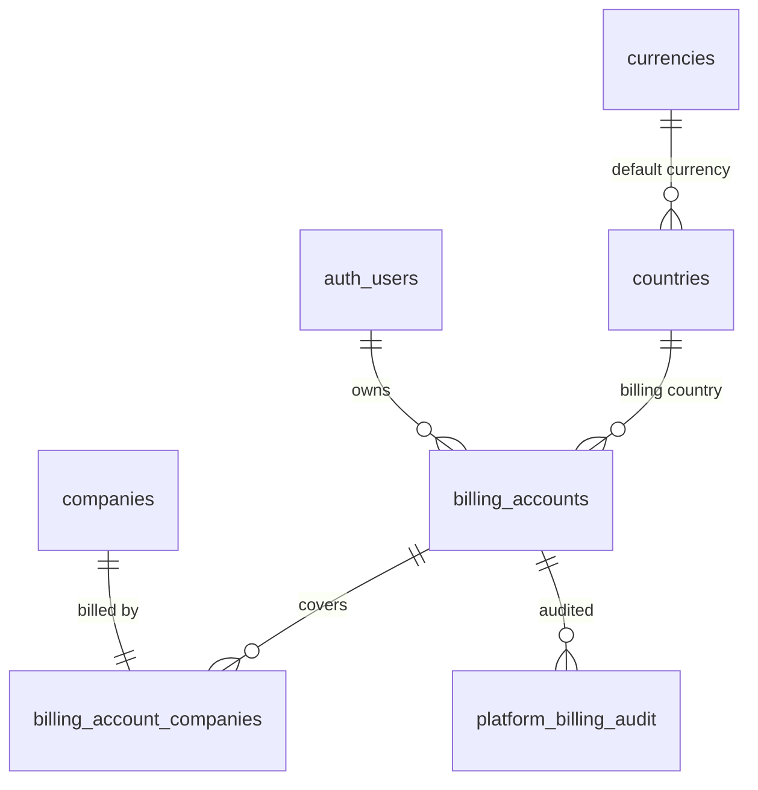

# Billing platform — database design

## Principles

- PostgreSQL is the source of truth. New billing tables live in the **`billing` schema**, which
  is not exposed through the Supabase Data API. Clients and server code reach them only through
  `SECURITY DEFINER` functions that check permissions (`search_path = ''`).
- RLS is enabled on every billing table with no client policies and no table grants to `anon`
  or `authenticated` (deny by default, defence in depth).
- Money is `bigint` minor units; exchange rates will be `numeric`. No floats.
- Migrations are additive and idempotent. The test harness applies each billing migration twice.

## Phase 1 migrations

| File                                        | Contents                                                                                                                                                                                                                        |
| ------------------------------------------- | ------------------------------------------------------------------------------------------------------------------------------------------------------------------------------------------------------------------------------- |
| `20261105161752_billing_reference_data.sql` | `billing` schema; `billing.currencies` (155 ISO 4217 currencies with exponents), `billing.countries` (249 ISO 3166-1 countries, current currency, `billing_enabled = false`); `public.billing_reference_data()` (anon-readable) |
| `20261105161753_billing_audit_chain.sql`    | `platform_billing_audit` gains `seq`, `billing_account_id`, `prev_hash`, `row_hash`; SHA-256 chain trigger; `billing.write_audit` (internal); `public.platform_verify_billing_audit_chain()` (platform billing staff, aal2)     |
| `20261105161754_billing_accounts.sql`       | `billing.billing_accounts`, `billing.billing_account_companies`; integrity triggers; organisation account per company (trigger + backfill); billing permissions; account functions                                              |

## Phase 2 migration

`20261105164327_billing_plans_catalogue.sql`:

| Object                                                       | Change                                                                                                                                                                                             |
| ------------------------------------------------------------ | -------------------------------------------------------------------------------------------------------------------------------------------------------------------------------------------------- |
| `billing_plans`                                              | `plan_rank`, `trial_enabled`, `trial_days` (1–365), `pricing_source` (`legacy` or `price_book`); STANDARD/PRO/BUSINESS upserted only while still `legacy`, so a rerun never overwrites later edits |
| `billing_features`                                           | `availability` (`available` or `coming_soon`); 11 new feature keys                                                                                                                                 |
| `plan_versions`, `plan_version_limits`                       | One published version per new plan (marked by reason `Billing platform phase 2 catalogue`); the previous top-tier PRO version is archived                                                          |
| `billing.trial_eligibility_rules`                            | `max_trials_per_user`, `max_trials_per_billing_account` (on, maximum 1)                                                                                                                            |
| `billing.trial_grants`                                       | One row per organisation that started a trial (signup, manual or backfill); no foreign key so history survives deletion                                                                            |
| `attach_company_subscription`                                | Demo: complimentary `practice`. Eligible: trial on the configured plan for that plan's length, recorded as a grant. Otherwise: `expired` (read-only)                                               |
| `start_company_trial`                                        | Requires a trial-enabled plan and eligibility; records a grant                                                                                                                                     |
| `enforce_subscription_seats`                                 | Lets the creator become the first owner of a read-only organisation; every other seat still needs an allowance                                                                                     |
| `enforce_company_allowance`, `private.platform_price_action` | Plan ranking and the plan list come from `billing_plans` instead of hardcoded codes                                                                                                                |
| `list_public_billing_plans`                                  | Adds `pricingSource`, `trial` and `features` (with limit, metering and availability); prices only for plans checkout can charge                                                                    |
| `billing_checkouts` / `company_subscriptions` guards         | Legacy checkout and paid plan changes refuse plans without a legacy price (`23514`)                                                                                                                |

Reference data is generated by `scripts/generate-billing-reference-data.mjs` from the official
sources into both the migration seed and `src/lib/billing/reference/iso-reference-data.ts`. A unit
test asserts the two are identical.

## Entities

### `billing.billing_accounts`

| Column                                        | Notes                                                                                                                  |
| --------------------------------------------- | ---------------------------------------------------------------------------------------------------------------------- |
| `account_type`                                | `INDIVIDUAL` or `ORGANIZATION`; immutable after creation                                                               |
| `owner_user_id`                               | Immutable. INDIVIDUAL: the only user with access. ORGANIZATION: the creating user (access follows company permissions) |
| `billing_email`, `legal_name`, address fields | Billing profile; length-checked                                                                                        |
| `billing_country`, `country_source`           | Both set or both null; source is `IP_GEOLOCATION`, `USER_SELECTED` or `VERIFIED_BILLING_ADDRESS`                       |
| `user_limit`                                  | Required for INDIVIDUAL (default 1); null for ORGANIZATION (plan limits apply)                                         |
| `company_limit`                               | Companies the account may cover (default 1)                                                                            |
| `status`                                      | `ACTIVE` or `CLOSED`; closed accounts cannot reopen                                                                    |

Constraints: one active INDIVIDUAL account per user; a company links to exactly one account; a
link requires an active account within its `company_limit` (row-locked check).

### Triggers

| Trigger                                                   | Purpose                                                                            |
| --------------------------------------------------------- | ---------------------------------------------------------------------------------- |
| `companies_billing_account` (after insert on `companies`) | Creates the ORGANIZATION account for every new company                             |
| `company_members_individual_user_limit`                   | Blocks a second non-accountant member on a company billed to an INDIVIDUAL account |
| `billing_accounts_identity`                               | Blocks changes to type/owner and reopening closed accounts                         |
| `billing_account_companies_guard`                         | Active account and company-limit checks                                            |
| `platform_billing_audit_hash`                             | Serialised SHA-256 chain over each new audit row                                   |

### Functions

| Function                                                                | Caller              | Check                                                                                                    |
| ----------------------------------------------------------------------- | ------------------- | -------------------------------------------------------------------------------------------------------- |
| `billing_reference_data()`                                              | anon, authenticated | Public reference data only                                                                               |
| `billing_my_accounts()`                                                 | authenticated       | Accounts the user can view (`billing.view`)                                                              |
| `billing_account_for_company(company)`                                  | authenticated       | `billing.view` on that company                                                                           |
| `billing_update_account_profile(account, profile, expected_updated_at)` | authenticated       | `billing.manage`; field allow-list; ISO country; optimistic concurrency (`40001` on stale data); audited |
| `billing_use_individual_account(company)`                               | authenticated       | Active owner; no other non-accountant members; respects company limit; audited                           |
| `billing_use_organization_account(company)`                             | authenticated       | Active owner; audited                                                                                    |
| `platform_verify_billing_audit_chain()`                                 | platform            | `private.platform_can('billing.view')` (aal2 + valid session)                                            |

## Testing

- `npm run test:billing:postgres`: isolated Postgres 17 container, synthetic fixture
  (`tests/fixtures/billing/baseline.sql`, with verbatim copies of the hosted access helpers), each
  billing migration applied twice, then `tests/integration/billing-accounts.sql` (54 assertions)
  and `tests/integration/billing-plans.sql` (59 assertions).
- `tests/fixtures/billing/legacy-catalogue.sql` holds the pre-series subscription stack (catalogue
  tables, entitlement functions verbatim, catalogue rows without user or provider identifiers),
  extracted from the restored production copy, plus a Growth trial and a paid Starter subscription
  so the data migration is exercised.
- Phase 2 rehearsal on the restored production copy: applied twice; the Growth trial moved to PRO
  with its end date kept; a person's first organisation (created through `create_company`) got a
  30-day PRO trial and a linked grant, the second opened read-only with its owner; a person who had
  trialled before was refused a manual trial; the checkout and paid plan-change guards fired; PRO
  resolved to 5 users through `get_entitlements`; platform staff changed a trial and drafted limits
  while a non-platform user was refused. All in a rolled-back transaction.
- Rehearsal on a restored copy of production (5 November 2026): all three migrations applied twice
  without errors; the three existing companies received ORGANIZATION accounts with their countries;
  real owners could manage billing at aal2; a non-member was refused; a new company created through
  every existing trigger received an account; the chain verifier ran under real platform session rules.
  All checks ran in a rolled-back transaction.

## Hosted apply procedure

Phases 1 and 2 are **not applied** to project `ipxflpzfcqwtenodbxwc`. When approved:

1. Take a restore-verified backup (`supabase db dump --linked` roles/schema/auth+storage/data,
   restore into `supabase/postgres` and compare row counts).
2. Rehearse the migrations on that restored copy.
3. Apply each migration in its own transaction, record versions with
   `supabase migration repair --status applied <version>`.
4. Run the Supabase security and performance advisors and the behavioural checks above.
