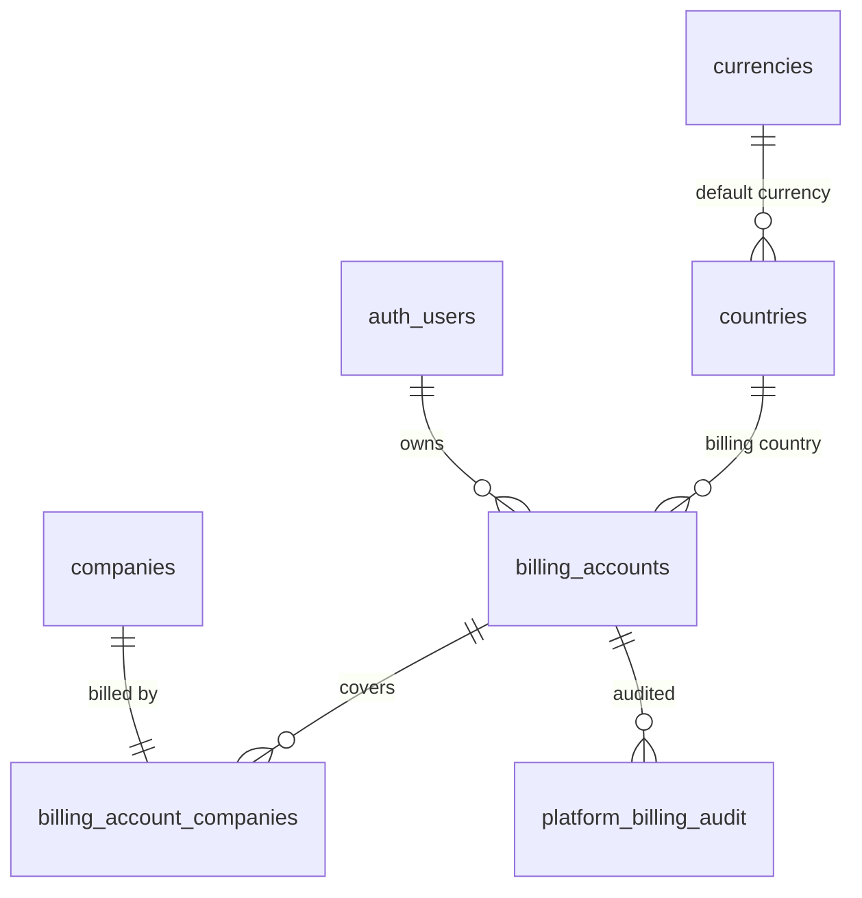

# Billing platform — database design

## Principles

- PostgreSQL is the source of truth. New billing tables live in the **`billing` schema**, which
  is not exposed through the Supabase Data API. Clients and server code reach them only through
  `SECURITY DEFINER` functions that check permissions (`search_path = ''`).
- RLS is enabled on every billing table with no client policies and no table grants to `anon`
  or `authenticated` (deny by default, defence in depth).
- Money is `bigint` minor units; exchange rates will be `numeric`. No floats.
- Migrations are additive and idempotent. The test harness applies each billing migration twice.

## Phase 1 migrations

| File                                        | Contents                                                                                                                                                                                                                        |
| ------------------------------------------- | ------------------------------------------------------------------------------------------------------------------------------------------------------------------------------------------------------------------------------- |
| `20261105161752_billing_reference_data.sql` | `billing` schema; `billing.currencies` (155 ISO 4217 currencies with exponents), `billing.countries` (249 ISO 3166-1 countries, current currency, `billing_enabled = false`); `public.billing_reference_data()` (anon-readable) |
| `20261105161753_billing_audit_chain.sql`    | `platform_billing_audit` gains `seq`, `billing_account_id`, `prev_hash`, `row_hash`; SHA-256 chain trigger; `billing.write_audit` (internal); `public.platform_verify_billing_audit_chain()` (platform billing staff, aal2)     |
| `20261105161754_billing_accounts.sql`       | `billing.billing_accounts`, `billing.billing_account_companies`; integrity triggers; organisation account per company (trigger + backfill); billing permissions; account functions                                              |

## Phase 2 migration

`20261105164327_billing_plans_catalogue.sql`:

| Object                                                       | Change                                                                                                                                                                                             |
| ------------------------------------------------------------ | -------------------------------------------------------------------------------------------------------------------------------------------------------------------------------------------------- |
| `billing_plans`                                              | `plan_rank`, `trial_enabled`, `trial_days` (1–365), `pricing_source` (`legacy` or `price_book`); STANDARD/PRO/BUSINESS upserted only while still `legacy`, so a rerun never overwrites later edits |
| `billing_features`                                           | `availability` (`available` or `coming_soon`); 11 new feature keys                                                                                                                                 |
| `plan_versions`, `plan_version_limits`                       | One published version per new plan (marked by reason `Billing platform phase 2 catalogue`); the previous top-tier PRO version is archived                                                          |
| `billing.trial_eligibility_rules`                            | `max_trials_per_user`, `max_trials_per_billing_account` (on, maximum 1)                                                                                                                            |
| `billing.trial_grants`                                       | One row per organisation that started a trial (signup, manual or backfill); no foreign key so history survives deletion                                                                            |
| `attach_company_subscription`                                | Demo: complimentary `practice`. Eligible: trial on the configured plan for that plan's length, recorded as a grant. Otherwise: `expired` (read-only)                                               |
| `start_company_trial`                                        | Requires a trial-enabled plan and eligibility; records a grant                                                                                                                                     |
| `enforce_subscription_seats`                                 | Lets the creator become the first owner of a read-only organisation; every other seat still needs an allowance                                                                                     |
| `enforce_company_allowance`, `private.platform_price_action` | Plan ranking and the plan list come from `billing_plans` instead of hardcoded codes                                                                                                                |
| `list_public_billing_plans`                                  | Adds `pricingSource`, `trial` and `features` (with limit, metering and availability); prices only for plans checkout can charge                                                                    |
| `billing_checkouts` / `company_subscriptions` guards         | Legacy checkout and paid plan changes refuse plans without a legacy price (`23514`)                                                                                                                |

## Phase 3 migration

`20261105173804_billing_pricing_engine.sql` (details in [07-country-pricing.md](07-country-pricing.md)):

| Object                                                                                                                                                        | Change                                                                                                                                                                                    |
| ------------------------------------------------------------------------------------------------------------------------------------------------------------- | ----------------------------------------------------------------------------------------------------------------------------------------------------------------------------------------- |
| `billing.price_inputs`, `billing.country_pricing_rules`, `billing.exchange_rates`                                                                             | New; RLS on, no client grants; rates append-only                                                                                                                                          |
| `plan_versions.price_book`                                                                                                                                    | Marks versions priced by country (phase 2 catalogue versions backfilled)                                                                                                                  |
| `plan_prices`                                                                                                                                                 | `country_code`, `strategy`, FX snapshot columns; uniqueness is per currency for rows without a country and per country otherwise; published/archived rows immutable                       |
| `billing.round_ratio`, `billing.fx_convert`, `billing.latest_rate`, `billing.country_price_rows`                                                              | Internal helpers                                                                                                                                                                          |
| `platform_set_country_pricing_rule`, `platform_set_price_input`, `platform_record_exchange_rate`, `platform_draft_country_prices`, `platform_country_pricing` | Platform staff (aal2), validated, audited                                                                                                                                                 |
| `private.platform_price_action`                                                                                                                               | Single-price drafts refused for price-book plans; price-book publish needs a different owner and a USD monthly base; rollback only to price-book versions; copies keep every price column |
| `platform_draft_plan_limits`                                                                                                                                  | Copies every price column and the price-book flag                                                                                                                                         |
| `billing_price_list(country)`                                                                                                                                 | Anonymous; published price-book prices for a country                                                                                                                                      |

## Phase 4 migrations

| File                                                | Contents                                                                                                                                                                                                                                                                                                       |
| --------------------------------------------------- | -------------------------------------------------------------------------------------------------------------------------------------------------------------------------------------------------------------------------------------------------------------------------------------------------------------- |
| `20261105175644_billing_legal_documents.sql`        | `billing.legal_documents` (versioned, immutable after approval, one published per kind and language), `billing.legal_acceptances` (append-only); public published list; draft/approve/publish/retire for platform staff; acceptance recording                                                                  |
| `20261105175645_billing_subscription_lifecycle.sql` | `billing.subscription_events` (append-only, trigger on `company_subscriptions`, backfilled), `billing.cancellation_requests`; state/cancel/reverse/notice functions; platform pause/resume; `billing.run_lifecycle_sweep`; `billing_lifecycle` job kind and 15-minute schedule in the existing platform worker |

## Phase 5 migration

`20261105182042_billing_payment_pipeline.sql` (details in [06-payment-integration.md](06-payment-integration.md)):
provider routes and `billing.country_providers`; provider price mappings; `billing_events` extended
into a durable store (payload, status, attempts, backoff, mode, result) with receive/claim/finish/due
functions; snapshot columns on `billing_checkouts` and `company_subscriptions`; checkout and paid
plan-change guards accept published price-book snapshots; `billing_apply_provider_event`;
provider-confirmed cancellation and reversal; customer-authorised plan changes recorded by the
service role; history records activations, renewals, failures and requested changes; country
billing toggle, route editing and webhook requeue for platform staff.

## Phase 6 migration

`20261105184413_billing_invoicing_and_tax.sql` (details in [08-tax-and-accounting.md](08-tax-and-accounting.md)):
customer tax ID on billing accounts; `billing.seller_entities`, `billing.invoice_series`,
`billing.tax_rules`, `billing.provider_tax_rate_mappings`, `billing.payments`, `billing.invoices`,
`billing.invoice_lines`, `billing.refunds`, `billing.credit_notes` (RLS on, no client grants,
immutability triggers); gapless numbering; tax arithmetic; invoice issue on recorded payments;
refund workflow; customer document functions; checkout price with tax; country readiness check;
private `billing-documents` storage bucket.

## Phase 10 migration

`20261105231127_billing_analytics.sql` (details in [02-admin-analytics.md](02-admin-analytics.md)):
read-only `billing.analytics_snapshot` behind `platform_billing_analytics` (aal2, `billing.view`)
and the service-role `billing_api_analytics` for API keys with `billing:analytics`.

## Phase 9 migration

`20261105230114_billing_api_v1.sql` (details in [05-api-reference.md](05-api-reference.md)):
`platform_api_keys` gains `scopes` and `last_used_at`; owner-only scope grants; service-role key
authentication; `billing.api_idempotency` (per caller, 24 hours); service-role keyset read models
for invoices, payments and subscriptions; `platform_billing_api_access` for staff tokens.

## Phase 8 migration

`20261105224027_billing_partners.sql` (details in [09-referral-commission.md](09-referral-commission.md)):
`platform_partners` extended (firm, status, verification); `billing.partner_users`,
`partner_program` (singleton: attribution model and window, payouts flag) with two-person
`partner_program_changes`; `referral_codes`, `referral_touches` (each with its disclosure
acceptance) and `referral_attributions`; `commission_rules` (second-owner approval, frozen once
approved); append-only `commission_ledger` fed by triggers on invoices and credit notes;
`partner_payouts` (manual, two-person, disabled by default).

## Phase 7 migration

`20261105223023_billing_coupons.sql` (details in [03-coupons.md](03-coupons.md)): `billing_offers`
extended (countries, duration type, per-account limit, minimum purchase, stacking off);
`billing.coupon_redemptions` (reserved/redeemed/released per checkout) and
`billing.provider_coupon_mappings`; quote, attach, redeem and provider-mapping functions; platform
coupon list, save and Razorpay offer linking; discount and code on payments and invoices.

Reference data is generated by `scripts/generate-billing-reference-data.mjs` from the official
sources into both the migration seed and `src/lib/billing/reference/iso-reference-data.ts`. A unit
test asserts the two are identical.

## Entities

### `billing.billing_accounts`

| Column                                        | Notes                                                                                                                  |
| --------------------------------------------- | ---------------------------------------------------------------------------------------------------------------------- |
| `account_type`                                | `INDIVIDUAL` or `ORGANIZATION`; immutable after creation                                                               |
| `owner_user_id`                               | Immutable. INDIVIDUAL: the only user with access. ORGANIZATION: the creating user (access follows company permissions) |
| `billing_email`, `legal_name`, address fields | Billing profile; length-checked                                                                                        |
| `billing_country`, `country_source`           | Both set or both null; source is `IP_GEOLOCATION`, `USER_SELECTED` or `VERIFIED_BILLING_ADDRESS`                       |
| `user_limit`                                  | Required for INDIVIDUAL (default 1); null for ORGANIZATION (plan limits apply)                                         |
| `company_limit`                               | Companies the account may cover (default 1)                                                                            |
| `status`                                      | `ACTIVE` or `CLOSED`; closed accounts cannot reopen                                                                    |

Constraints: one active INDIVIDUAL account per user; a company links to exactly one account; a
link requires an active account within its `company_limit` (row-locked check).

### Triggers

| Trigger                                                   | Purpose                                                                            |
| --------------------------------------------------------- | ---------------------------------------------------------------------------------- |
| `companies_billing_account` (after insert on `companies`) | Creates the ORGANIZATION account for every new company                             |
| `company_members_individual_user_limit`                   | Blocks a second non-accountant member on a company billed to an INDIVIDUAL account |
| `billing_accounts_identity`                               | Blocks changes to type/owner and reopening closed accounts                         |
| `billing_account_companies_guard`                         | Active account and company-limit checks                                            |
| `platform_billing_audit_hash`                             | Serialised SHA-256 chain over each new audit row                                   |

### Functions

| Function                                                                | Caller              | Check                                                                                                    |
| ----------------------------------------------------------------------- | ------------------- | -------------------------------------------------------------------------------------------------------- |
| `billing_reference_data()`                                              | anon, authenticated | Public reference data only                                                                               |
| `billing_my_accounts()`                                                 | authenticated       | Accounts the user can view (`billing.view`)                                                              |
| `billing_account_for_company(company)`                                  | authenticated       | `billing.view` on that company                                                                           |
| `billing_update_account_profile(account, profile, expected_updated_at)` | authenticated       | `billing.manage`; field allow-list; ISO country; optimistic concurrency (`40001` on stale data); audited |
| `billing_use_individual_account(company)`                               | authenticated       | Active owner; no other non-accountant members; respects company limit; audited                           |
| `billing_use_organization_account(company)`                             | authenticated       | Active owner; audited                                                                                    |
| `platform_verify_billing_audit_chain()`                                 | platform            | `private.platform_can('billing.view')` (aal2 + valid session)                                            |

## Testing

- `npm run test:billing:postgres`: isolated Postgres 17 container, synthetic fixture
  (`tests/fixtures/billing/baseline.sql`, with verbatim copies of the hosted access helpers), each
  billing migration applied twice, then `tests/integration/billing-01-accounts.sql` (54 assertions),
  `tests/integration/billing-02-plans.sql` (59 assertions) and
  `tests/integration/billing-03-pricing.sql` (60 assertions), `tests/integration/billing-04-provider-payments.sql`
  (54 assertions), `tests/integration/billing-05-subscriptions.sql` (52 assertions) and
  `tests/integration/billing-06-tax-invoicing.sql` (60 assertions) , `tests/integration/billing-07-coupons.sql`
  (37 assertions) , `tests/integration/billing-08-partners.sql` (57 assertions) and
  `tests/integration/billing-09-api.sql` (34 assertions) and `tests/integration/billing-10-analytics.sql`
  (19 assertions). Suites run in file-name order on one database. The legacy fixture also carries the platform worker tables and the production
  worker tick so the lifecycle job runs through the real scheduler.
- Phase 10 rehearsal on the restored production copy: Phases 8 to 10 applied twice; a platform owner
  read a 90-day snapshot (one non-demo subscription, trialing; no paid MRR yet); a range over a
  year, a non-MFA session and client calls to the service variant were refused.
- Phase 9 rehearsal on the restored production copy: applied twice with Phase 8; a platform owner
  granted `billing:read` to a key; the key authenticated with that scope; clients were refused the
  read models; the three existing subscriptions were listed; idempotency keys started cleanly.
- Phase 8 rehearsal on the restored production copy: applied twice; a firm applied after accepting
  the partner terms; its owner could not approve it, and approval without recorded evidence was
  refused; codes were refused while pending; referrals were refused until a second owner set the
  attribution window; enabling payouts without a regulatory reference was refused; the customer's
  disclosure acceptance was recorded; a rule drafted by one owner was approved by the other; a
  ₹999 invoice (₹846.61 net) accrued ₹84.66 at a rehearsal-only 10% and a half refund reversed
  ₹42.33; the ledger could not be edited; payouts were refused while disabled and, once enabled,
  could not be requested or approved by partner members or the requester.
- Phase 6 rehearsal on the restored production copy: applied twice; opening India was refused while
  no seller or rule existed; seller activation and rule approval were refused for their author and
  done by the other owner; an overlapping rule and an exclusive rule for Razorpay were refused; a ₹999
  Razorpay payment issued LB/IN/000001 (₹846.61 + GST ₹152.39) and the next LB/IN/000002; replays were
  idempotent; issued invoices could not be edited or deleted; a ₹500 refund requested by one owner and
  approved by the other produced CN/IN/000001 (₹423.73 + ₹76.27); a payment for a country without a
  seller stayed pending with its reason; clients were refused every service function.
- Phase 5 rehearsal on the restored production copy: applied twice; launch prices drafted by one
  owner and published by the other; India checkout refused while closed and for a tampered amount,
  accepted at ₹999 once opened; a Razorpay activation applied once and its replay skipped; a renewal
  recorded; an older failure skipped as stale; a downgrade held until renewal; an upgrade applied
  only on the confirming event; a provider cancellation waited for confirmation and was final for
  Razorpay; the webhook store deduplicated, claimed once and scheduled retries; clients and outsiders
  were refused every service and platform function.
- Phase 4 rehearsal on the restored production copy: applied twice; history backfilled for the three
  existing subscriptions; a new organisation's trial cancellation was scheduled for the trial end
  with full access kept, reversed, refused without the newly published policy, and recorded with it;
  the real worker tick ran the sweep, ended the due cancellation (read-only afterwards) and raised one
  past-due alert; a second sweep changed nothing; trial expiry, pause and resume worked; outsiders
  were refused.
- Phase 3 rehearsal on the restored production copy: applied twice; with the two real platform
  owners, one drafted the launch prices and was refused publishing them, the other published; India
  saw ₹499/₹999/₹1,999, the US and unknown countries $10/$20/$50; AU, JP and KW FX rules converted
  exactly (A$15.23, ¥7,569 on a half, KWD 3.148 with markup); a draft without rates listed every
  missing rate; published prices could not be edited; rollback restored the previous price-book
  version and never the retired PRO prices; legacy checkout still refused the new plans.
- `tests/fixtures/billing/legacy-catalogue.sql` holds the pre-series subscription stack (catalogue
  tables, entitlement functions verbatim, catalogue rows without user or provider identifiers),
  extracted from the restored production copy, plus a Growth trial and a paid Starter subscription
  so the data migration is exercised.
- Phase 2 rehearsal on the restored production copy: applied twice; the Growth trial moved to PRO
  with its end date kept; a person's first organisation (created through `create_company`) got a
  30-day PRO trial and a linked grant, the second opened read-only with its owner; a person who had
  trialled before was refused a manual trial; the checkout and paid plan-change guards fired; PRO
  resolved to 5 users through `get_entitlements`; platform staff changed a trial and drafted limits
  while a non-platform user was refused. All in a rolled-back transaction.
- Rehearsal on a restored copy of production (5 November 2026): all three migrations applied twice
  without errors; the three existing companies received ORGANIZATION accounts with their countries;
  real owners could manage billing at aal2; a non-member was refused; a new company created through
  every existing trigger received an account; the chain verifier ran under real platform session rules.
  All checks ran in a rolled-back transaction.

## Hosted apply procedure

Phases 1 to 10 were **applied to production** (`ipxflpzfcqwtenodbxwc`) on 6 November 2026:

1. A read-only pre-check matched the rehearsed state (3 companies, 3 subscriptions, 29 features, no
   `billing` schema).
2. All 13 migrations ran on production in one transaction that was forced to roll back (dry run);
   nothing persisted.
3. The 13 migrations and their history rows (repository versions `20261105161752` to
   `20261105231127`) were applied in one atomic transaction with `supabase db query --remote --file`.
   `supabase db push` was not used: production's history records many older repository migrations
   under different versions, so a push would re-run them.
4. Verified: 155 currencies, 249 countries, 40 features, 3 backfilled billing accounts and history
   events, RLS on every `billing` table with no client grants, payouts off and the partner window
   unset, the lifecycle job scheduled. The security and performance advisors raised only the
   project's existing classes of finding (security-definer RPCs with internal permission checks,
   intentionally public pricing functions, and older policies on `billing_offers`, `billing_plans`
   and `billing_checkouts`).
