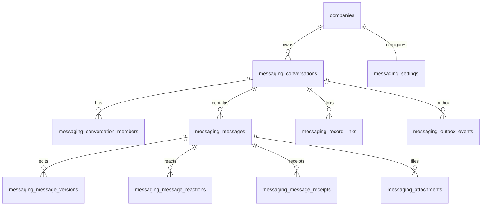

# Messaging architecture

## Principles

1. Durable PostgreSQL is the source of truth.  
2. Realtime notifies; clients re-fetch authorized rows.  
3. Default-deny RLS + security-definer RPCs for mutations.  
4. Participant membership is required for every read/write.  
5. Portal and firm access use existing invite/membership systems.  
6. Chat never mutates ledger balances.

## Entity overview

### Conversation types

`dm` | `group` | `channel` | `record` | `customer` | `vendor` | `hr_private` | `payroll_restricted` | `accountant_client` | `advisor_engagement`

### Visibility modes

`internal` | `restricted_management` | `hr_private` | `customer` | `vendor` | `accountant` | `advisor`

A customer linked to an invoice does **not** make an internal record thread external.

### Participant kinds

`member` (company_members) | `portal_customer` | `portal_vendor` | `advisor` | `system`

## Message delivery

1. Client generates `idempotency_key` (UUID).  
2. `messaging_send_message` RPC inserts message in a transaction.  
3. Same transaction inserts `messaging_outbox_events` + optional `action_notifications`.  
4. Trigger/broadcast notifies subscribers with **minimal payload** (`conversation_id`, `seq`, `event`).  
5. Clients invalidate queries and fetch via RLS-protected select/RPC.  
6. On reconnect, clients request messages with `seq > last_seen_seq`.

## Channel strategy

- Prefer private channels keyed by `conversation_id` after membership check.  
- Presence: low-frequency online/away.  
- Typing: ephemeral broadcast, not persisted.  
- On membership revoke: mark member removed; rotate `channel_epoch`; stop serving bodies to revoked listeners.

## API surface (server functions)

| Function | Purpose |
| -------- | ------- |
| `listMessagingConversations` | Inbox filters |
| `listMessagingConversationMembers` | Active members |
| `createDirectConversation` | DM find-or-create |
| `createGroupConversation` | Group create |
| `addMessagingInternalMembers` | Invite internal members |
| `sendMessagingMessage` | Idempotent send (rate-limited) |
| `listMessagingMessages` / `searchMessagingMessages` | Cursor/seq + thread search |
| `markMessagingRead` / `markMessagingUnread` | Receipts + unread |
| `listMessagingMessageReceipts` | Read receipts |
| `updateMessagingMembership` | Mute/archive/leave/star |
| `blockMessagingUser` / `unblockMessagingUser` | Peer blocks |
| `openRecordDiscussion` / portal open helpers | Record + portal discuss |
| `requestMessagingFormalApproval` | Formal approval handoff |
| `getMessagingUnreadCount` | Header badge |
| `listEligibleMessagingParticipants` | Discovery |
| `setMessagingCollaborationFlags` / `setMessagingRetentionDays` | Org settings |
| `previewMessagingDigest` / digest-cron worker | Safe digests |

## Module registration contract

Future modules register via `src/lib/messaging/module-adapters.ts`:

- `recordType`, deep link builder  
- Participant eligibility  
- Permission requirements  
- Visibility defaults  
- Retention classification  
- Optional approval action keys  

External messaging stays off until the module explicitly enables it and tests pass.

## Migration & rollback

- Additive migrations only (`messaging_*` tables).  
- Feature flag defaults off until smoke tests pass.  
- Rollback: disable flag; do not drop tables with retained audit data without explicit authorization.  
- Bridge RPCs may dual-read `portal_messages` during transition.

## Test strategy

- Unit: validation, eligibility, ordering, idempotency, retention.  
- Integration SQL: RLS cross-tenant, membership revoke, IDOR.  
- E2E: two-browser realtime, portal invoice discuss, firm isolation.  
- Security: XSS render, attachment after revoke, rate limits.
